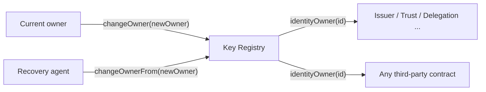

# Key Registry Specification

# Abstract

The Key Registry is the root of the identity stack. It answers exactly one question, for
any identifier, at any point in time: which key controls this identifier right now?
It is a minimal subset of ERC-1056 (did:ethr)
in which every Ethereum address is implicitly a decentralised identifier (DID) at zero
cost, and the registry stores only deviations from the default state of self-ownership.
Every other component in the stack resolves control through a single view call,
identityOwner(identity), so a single key rotation recorded here propagates control of
every registration, everywhere, with no per-component migration.

# Status of This Memo

This document is a working specification derived from a reference implementation. It is **not** an IETF document and has not been reviewed by any IETF working group; it is distributed for evaluation and discussion. It adopts IETF conventions — BCP 14 requirement keywords, Security and Privacy Considerations, an IANA Considerations section, and split references — so that institutional reviewers can read it against familiar structure, but it claims no IETF status.

Changes are made by pull request against the source repository. The reference implementation in `src/DIDRegistry.sol` and its test suite are normative where this prose is ambiguous.

# Copyright Notice

This specification is published under the MIT license of the repository that contains it (see `LICENSE`). Contributors retain copyright in their contributions and license them under those terms. A formal IETF submission would instead be governed by the IETF Trust's Legal Provisions (BCP 78) and the rights described in BCP 79; this notice is provided in their place for a non-IETF document.

# Conventions and Terminology

The key words "MUST", "MUST NOT", "REQUIRED", "SHALL", "SHALL NOT", "SHOULD", "SHOULD
NOT", "RECOMMENDED", "MAY", and "OPTIONAL" in this document are to be interpreted as
described in BCP 14 [RFC2119] [RFC8174] when, and only when, they appear in all
capitals, as shown here.

## Terminology

- **Identifier / DID.** An Ethereum address treated as a decentralised identifier.
- **Controller / owner.** The address currently authorised to act for an identifier.
- **Delegate.** A key-typed, expiring capability that does not confer ownership.
- **Recovery agent.** A pre-authorised contract permitted to rotate ownership along the
  recovery path.

# Introduction

Every downstream identity function — issuing, accrediting, revoking, delegating, settling
— must be gated on control of an identifier, and that gate MUST survive the two events
that break naive key-based systems: **rotation** (the controller deliberately changes
keys) and **loss** (the controller loses access to a key). A system that binds
registrations directly to a public key forces re-enrolment with every counterparty each
time a key changes, which is both the dominant operational cost of key management and its
dominant security hazard, because re-enrolment flows are where impersonation happens.

Anchoring an identifier in a shared registry solves this by adding one level of
indirection: registrations bind to the *identifier*, and the identifier's controller is a
mutable pointer. This specification deliberately chooses the lightest form of that
pattern, following the evaluation in *Methods for Decentralized Identities* (see
[References](#references)): no registration transaction, no fee to exist, and state
written only when control deviates from the default. The cost of that lightness is
addressed under [Security and Privacy Considerations](#security-and-privacy-considerations):
the registry's own attack surface is small, but it inherits every weakness of the
underlying key, and an identifier reused across contexts is a correlation handle.

# Specification

## System Requirements

An implementation MUST provide:

- A deterministic mapping from every address to a current controller, defaulting to the
  address itself.
- An owner-only operation to rotate that controller.
- A recovery-agent operation to rotate that controller along a pre-authorised path.
- Expiring, key-typed delegates that do not affect ownership.
- An event log sufficient for an off-chain resolver to reconstruct the full history of an
  identifier without additional trusted state.

## Data Structures

```text
_owners:        mapping(address => address)   // empty (address(0)) == self-owned
recoveryAgent:  mapping(address => address)   // pre-authorised rotation agent, or zero
_delegates:     mapping(address =>            // identity
                  mapping(bytes32 =>          //   delegate type
                    mapping(address =>        //     delegate address
                      uint256)))              //       valid-until (unix seconds)
changed:        mapping(address => uint256)   // block number of the identity's last event
```

The `changed` pointer is the backbone of off-chain resolution: each event carries the
`previousChange` block number, so a resolver reconstructs an identifier's document by
reading `changed[identity]` once and walking the event chain backwards. Resolution
therefore costs one storage read plus a bounded set of targeted log queries.

## Interface

| Function | Access | Effect |
|---|---|---|
| `identityOwner(address identity) → address` | view | Returns `_owners[identity]`, or `identity` itself when unset. Never reverts. |
| `changeOwner(address identity, address newOwner)` | current owner | Rotates the controller. Total transfer — the old key retains nothing. |
| `changeOwnerFrom(address identity, address newOwner)` | recovery agent | Recovery-path rotation; callable only by the pre-set `recoveryAgent[identity]`. |
| `setRecoveryAgent(address identity, address agent)` | current owner | Pre-authorises a recovery contract (see 02/RECOVERY-MODULE). |
| `addDelegate(address identity, bytes32 type, address delegate, uint256 validity)` | current owner | Grants a delegate valid for `validity` seconds from now. |
| `revokeDelegate(address identity, bytes32 type, address delegate)` | current owner | Expires a delegate immediately. |
| `validDelegate(address identity, bytes32 type, address delegate) → bool` | view | True iff the delegate's valid-until is strictly in the future. |

**Errors.** `changeOwner`, `setRecoveryAgent`, `addDelegate`, and `revokeDelegate` MUST
revert `NotIdentityOwner` when `msg.sender != identityOwner(identity)`. `changeOwnerFrom`
MUST revert `NotRecoveryAgent` when `msg.sender != recoveryAgent[identity]`.

**Events.** `DIDOwnerChanged(identity, owner, previousChange)`,
`DIDDelegateChanged(identity, delegateType, delegate, validTo, previousChange)`, and
`DIDRecoveryAgentChanged(identity, agent, previousChange)`. Every state-changing operation
MUST emit exactly one event and update `changed[identity]` to the current block number.

## Protocol Flow



Control resolution, performed by every other component:

1. Call `identityOwner(identity)`.
2. Compare the result to the transaction's authorised sender.

Rotation by the controller:

1. The current owner calls `changeOwner(identity, newOwner)`.
2. From the next block, `identityOwner(identity)` returns `newOwner`, and every component
   that resolves through this registry follows automatically.

Rotation by recovery:

1. The owner has previously called `setRecoveryAgent(identity, module)`.
2. The recovery module, having satisfied its own conditions, calls
   `changeOwnerFrom(identity, newOwner)`.

# Invariants

- **Default self-ownership.** An identity with no recorded state transition is controlled
  by itself and costs nothing to exist.
- **Total transfer.** After `changeOwner`/`changeOwnerFrom`, the previous controller
  retains no capability over the identifier.
- **Sole authority.** Only the current owner, or the pre-set recovery agent, can change
  ownership. Delegates never gain ownership authority.
- **Chain integrity.** `changed[identity]` always points at the block of the most recent
  event for that identity, and every event references the previous one, so the history is
  fully reconstructible from logs alone.

# Security and Privacy Considerations

## Assumptions

- The security of an identifier reduces entirely to the security of its current
  controlling key (or the recovery agent's own conditions). The registry adds no
  cryptography of its own.
- Off-chain resolution assumes access to the complete event log — an archive node or a
  trusted indexer.

## Threat model

- **Key theft is not key loss.** Rotation protects against loss; it does not protect
  against a thief who holds the *current* key, who can rotate ownership away or clear the
  recovery agent. Compromise tolerance for single-key control is unsolved at this layer,
  which is precisely why 02/RECOVERY-MODULE and 03/DELEGATION-REGISTRY exist as separate
  components. Implementations SHOULD pair this registry with a recovery module from day
  one.
- **Resurrection via the zero address.** Because an owner entry of `address(0)` denotes
  self-ownership, rotating ownership "to zero" returns control to the original address. An
  implementation or operator MUST NOT treat the zero address as a way to retire an
  identifier.
- **Delegate over-scope.** A compromised delegate cannot rotate the owner but can act
  within its type until expiry. Grants SHOULD use the shortest practical validity.
- **Event-log availability.** An adversary who degrades a relying party's access to
  historical logs degrades resolution. Operators SHOULD run their own archive or a
  redundant indexer.

## Privacy

An address used as a long-lived identifier is a permanent correlation handle: every
registration, accreditation, and settlement that references it is publicly linkable. The
DID evaluation literature is explicit that registry-anchored identifiers trade privacy for
auditability. Implementations that care about correlation MUST use **per-context
(pairwise) identifiers** — a fresh address per relationship — rather than one identifier
across all counterparties. No personal data is ever written to the registry, by
construction.

# Interoperability

Identifiers resolve as `did:ethr` under ERC-1056. Delegate types map onto DID-document
verification relationships: `veriKey` → `assertionMethod`, `sigAuth` → `authentication`.
Any ERC-1056-compatible resolver can consume identifiers produced by this registry,
provided it accounts for the additional `recoveryAgent` field, which the base standard
does not define.

# Implementation Notes and Production Path

- **Use the canonical registry.** In production, deploy against the already-deployed
  EthereumDIDRegistry (the same address on most networks) rather than redeploying this
  contract, inheriting years of scrutiny and existing resolver tooling. This contract
  exists to make the mechanism legible and to add the explicit `recoveryAgent` hook, which
  ERC-1056 implements instead via signed meta-transactions.
- **Resolver infrastructure is an operating cost.** Budget an archive node or a maintained
  indexer for event-chain resolution.
- **Smart-account layering.** For ERC-4337/7702 smart accounts, account-level key
  management and this DID layer are complementary: the account manages its signing key;
  this registry manages the identifier above it.

# IANA Considerations

This document is not currently on the IETF stream and requests no IANA actions at this time.

Were it submitted, it would establish a **Delegate Type registry**, replacing the enumeration that is presently defined inline — namely the delegate-type values used here (`veriKey`, `sigAuth`), which ERC-1056 already employs. The registry itself — its contents, allocation policy, and initial entries — is defined in [00/REGISTRIES]; the values remain defined inline here until that document is adopted.

# Normative References

- [RFC2119] Bradner, S., "Key words for use in RFCs to Indicate Requirement Levels", BCP 14, RFC 2119, March 1997 — https://www.rfc-editor.org/rfc/rfc2119
- [RFC8174] Leiba, B., "Ambiguity of Uppercase vs Lowercase in RFC 2119 Key Words", BCP 14, RFC 8174, May 2017 — https://www.rfc-editor.org/rfc/rfc8174
- ERC-1056: Ethereum Lightweight Identity — https://eips.ethereum.org/EIPS/eip-1056

# Informative References

- Methods for Decentralized Identities: Evaluation and Insights, IACR ePrint 2021/1087 — https://eprint.iacr.org/2021/1087
- A Taxonomic Approach to Understanding Emerging Blockchain Identity Management Systems, arXiv:1908.00929 — https://arxiv.org/pdf/1908.00929
