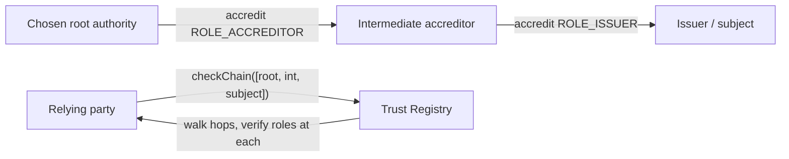

# Accreditation Registry Specification

# Abstract

The Accreditation Registry records who vouches for whom, in what role, for which
credential type, as an open graph with no global root. Any identifier MAY accredit any
other; each relying party independently chooses which authorities it treats as roots.
Withdrawal of an accreditation reaches every relying party in the next block.
checkChain walks a multi-step hierarchy — root → accreditor(s) → subject — in a single
view call, so eIDAS-style hierarchies resolve without an off-chain fetch.

# Status of This Memo

This document is a working specification derived from a reference implementation. It is **not** an IETF document and has not been reviewed by any IETF working group; it is distributed for evaluation and discussion. It adopts IETF conventions — BCP 14 requirement keywords, Security and Privacy Considerations, an IANA Considerations section, and split references — so that institutional reviewers can read it against familiar structure, but it claims no IETF status.

Changes are made by pull request against the source repository. The reference implementation in `src/TrustRegistry.sol` and its test suite are normative where this prose is ambiguous.

# Copyright Notice

This specification is published under the MIT license of the repository that contains it (see `LICENSE`). Contributors retain copyright in their contributions and license them under those terms. A formal IETF submission would instead be governed by the IETF Trust's Legal Provisions (BCP 78) and the rights described in BCP 79; this notice is provided in their place for a non-IETF document.

# Conventions and Terminology

The key words "MUST", "MUST NOT", "REQUIRED", "SHALL", "SHALL NOT", "SHOULD", "SHOULD
NOT", "RECOMMENDED", "MAY", and "OPTIONAL" in this document are to be interpreted as
described in BCP 14 [RFC2119] [RFC8174] when, and only when, they appear in all
capitals, as shown here.

## Terminology

- **Accreditation.** A vouching statement `(authority, subject, role, schema)`.
- **Role.** Issuer, verifier, or accreditor — the last enabling multi-step chains.
- **Root.** An authority a relying party chooses to trust; not a global property.
- **Chain walk.** Resolving root → accreditor(s) → subject in one call.

# Introduction

The hardest question in identity is not "is this credential valid?" but "why should I
believe this issuer?" Today that is answered by closed, jurisdiction-bound trusted lists
(the eIDAS List of Trusted Lists; DNS roots): signed files published on a schedule, cached
by relying parties, with a propagation window during which withdrawn trust keeps working.
The revocation-transparency literature documents both that window and the accountability
gap — a list maintainer can quietly rewrite history unless the log is public and
append-only.

This component makes two structural changes. First, revocation is immediate and its
history is permanent, following the ledger-backed revocation-transparency designs in
[References](#references). Second, and more fundamentally, there is **no root to agree
on**: authority is meaningless until a relying party names it, so jurisdictions with
incompatible — or no — mutual trust can operate over one shared record. This maps closely
onto how eIDAS hierarchies are actually shaped, minus the single list at the top.

# Specification

## System Requirements

An implementation MUST provide:

- Authority-authored accreditations naming a subject, a role, and a credential type, with
  an optional expiry and an off-chain document reference.
- Authority-authored revocation that leaves a permanent, timestamped trace.
- A validity predicate combining issuance, non-revocation, and non-expiry.
- A chain-walk predicate constraining intermediate links to the accreditor role.

## Data Structures

```text
ROLE_ISSUER     = keccak256("ROLE_ISSUER")
ROLE_VERIFIER   = keccak256("ROLE_VERIFIER")
ROLE_ACCREDITOR = keccak256("ROLE_ACCREDITOR")

Accreditation { uint64 issuedAt; uint64 expiry; uint64 revokedAt; string uri }
                // expiry == 0 means no expiry

accreditations: mapping(address =>          // authority
                  mapping(address =>        //   subject
                    mapping(bytes32 =>      //     role
                      mapping(bytes32 =>    //       schemaId
                        Accreditation))))
```

The same primitive accredits both ends of the trust triangle: `ROLE_ISSUER` for issuers,
`ROLE_VERIFIER` for verifiers (this is how the "verified verifiers" use case of
12/VERIFIER-REGISTRY is realised).

## Interface

| Function | Access | Effect |
|---|---|---|
| `accredit(address authority, address subject, bytes32 role, bytes32 schemaId, uint64 expiry, string uri)` | authority owner | Issue or refresh an accreditation. |
| `revoke(address authority, address subject, bytes32 role, bytes32 schemaId)` | authority owner | Revoke; sets `revokedAt` and leaves a permanent record. |
| `isAccredited(address authority, address subject, bytes32 role, bytes32 schemaId) → bool` | view | `issued ∧ ¬revoked ∧ ¬expired`. |
| `checkChain(address[] path, bytes32 role, bytes32 schemaId) → bool` | view | Walk `path[0]` (a chosen root) → intermediate accreditors → subject. |

**Errors.** `revoke` MUST revert `NotAccredited` when no accreditation exists.
Authority-gated functions resolve control through `DIDRegistry.identityOwner`. **Events.**
`Accredited(...)`, `AccreditationRevoked(...)`.

`checkChain` requires `path.length ≥ 2`; each intermediate hop MUST hold
`ROLE_ACCREDITOR` for the schema, and only the final hop is checked for the target `role`.

## Protocol Flow



Direct accreditation:

1. An authority calls `accredit(authority, issuer, ROLE_ISSUER, schemaId, expiry, uri)`.
2. A relying party that has *chosen this authority as a root* checks
   `isAccredited(authority, issuer, ROLE_ISSUER, schemaId)`.

Hierarchical accreditation (eIDAS-style):

1. A root accredits an intermediate with `ROLE_ACCREDITOR`; the intermediate accredits the
   subject with `ROLE_ISSUER`.
2. A relying party calls `checkChain([root, intermediate, subject], ROLE_ISSUER,
   schemaId)`.

# Invariants

- **Trust lives in the reader.** Anyone can accredit anyone; an accreditation carries no
  weight until a relying party selects its authority as a root.
- **Permanent revocation trace.** Revocations set a timestamp and are never erased,
  producing an audit trail of trust decisions — even a subsequent re-accreditation does
  not remove the record that a revocation occurred.
- **Constrained chains.** Every intermediate hop in `checkChain` MUST hold
  `ROLE_ACCREDITOR` for the schema, or a leaf accreditation could be laundered into
  authority it was never granted.

# Security and Privacy Considerations

## Threat model

- **Meaningless accreditations.** Because anyone may vouch, raw entries carry no weight;
  security lives entirely in each relying party's root-selection policy. That policy is an
  artefact the relying party MUST actually write, publish, and maintain.
- **Root-set capture or coercion.** The pressure that captured trusted lists moves to
  whoever maintains a widely-copied root policy. Plurality reduces the blast radius; it
  does not remove the incentive.
- **Chain confusion.** Addressed by the accreditor-role constraint above.
- **Revocation-history erasure.** Re-accreditation MUST NOT erase the record that a prior
  revocation happened; the permanent trace lives in events and is what regulators and
  researchers rely on.

## Privacy

Accreditations concern institutions and identifiers, not natural persons; no personal data
is stored. The off-chain `uri` MAY reference an audit report or terms; sensitive
constraint payloads SHOULD be kept off-chain and content-hashed.

# Interoperability

The role/subject/schema structure maps closely onto eIDAS trusted-list semantics and onto
the ToIP Trust Registry protocol's notion of authorisations. Jurisdictional roots are
supported without requiring a single global root, which is what allows competing
jurisdictions to share one record.

# Implementation Notes and Production Path

- **Publish your root policy** as a governed document: which authorities you accept, for
  which credential types, reviewed on a schedule.
- **Prefer short accreditation lifetimes with renewal** over long ones with revocation —
  expiry is the cheap, unambiguous path.
- **Monitor the graph around your own entries**; unexpected accreditations naming you are
  reputational events you want to see first.
- **Future work:** constraint payloads per accreditation (jurisdiction, credential
  limits), negative attestations (public warnings), and indexer-friendly enumeration.

# IANA Considerations

This document is not currently on the IETF stream and requests no IANA actions at this time.

Were it submitted, it would establish a **Trust Role registry**, replacing the enumeration that is presently defined inline — namely the role values `ROLE_ISSUER`, `ROLE_VERIFIER`, and `ROLE_ACCREDITOR`. The registry itself — its contents, allocation policy, and initial entries — is defined in [00/REGISTRIES]; the values remain defined inline here until that document is adopted.

# Normative References

- [RFC2119] Bradner, S., "Key words for use in RFCs to Indicate Requirement Levels", BCP 14, RFC 2119, March 1997 — https://www.rfc-editor.org/rfc/rfc2119
- [RFC8174] Leiba, B., "Ambiguity of Uppercase vs Lowercase in RFC 2119 Key Words", BCP 14, RFC 8174, May 2017 — https://www.rfc-editor.org/rfc/rfc8174

# Informative References

- SoK: Delegation and Revocation, the Missing Links in the Web's Chain of Trust, arXiv:1906.10775 — https://arxiv.org/pdf/1906.10775
- Postcertificates for Revocation Transparency, arXiv:2203.02280 — https://arxiv.org/pdf/2203.02280
- Blockchain-Based Certificate Transparency and Revocation Transparency, Springer (FC workshops) — https://link.springer.com/chapter/10.1007/978-3-662-58820-8_11
- Application of Public Ledgers to Revocation in Distributed Access Control, arXiv:1608.06592 — https://arxiv.org/pdf/1608.06592
