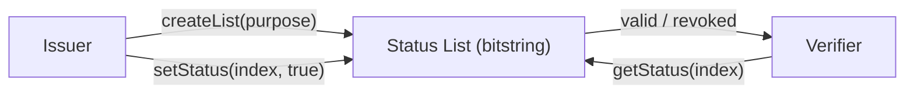

# Revocation Status Registry Specification

# Abstract

The Revocation Status Registry is an on-chain port of the
W3C Bitstring Status List: one bit
per credential, 256 bits per storage word, answering whether a credential is still
valid. A credential carries (issuer, listId, index); a verifier reads its status with a
single SLOAD. Revocation lists are one-way by contract invariant; suspension lists can be
cleared to reinstate. Because the list lives in shared state, the issuer is never contacted
at check time and so never learns where a credential is used.

# Status of This Memo

This document is a working specification derived from a reference implementation. It is **not** an IETF document and has not been reviewed by any IETF working group; it is distributed for evaluation and discussion. It adopts IETF conventions — BCP 14 requirement keywords, Security and Privacy Considerations, an IANA Considerations section, and split references — so that institutional reviewers can read it against familiar structure, but it claims no IETF status.

Changes are made by pull request against the source repository. The reference implementation in `src/StatusListRegistry.sol` and its test suite are normative where this prose is ambiguous.

# Copyright Notice

This specification is published under the MIT license of the repository that contains it (see `LICENSE`). Contributors retain copyright in their contributions and license them under those terms. A formal IETF submission would instead be governed by the IETF Trust's Legal Provisions (BCP 78) and the rights described in BCP 79; this notice is provided in their place for a non-IETF document.

# Conventions and Terminology

The key words "MUST", "MUST NOT", "REQUIRED", "SHALL", "SHALL NOT", "SHOULD", "SHOULD
NOT", "RECOMMENDED", "MAY", and "OPTIONAL" in this document are to be interpreted as
described in BCP 14 [RFC2119] [RFC8174] when, and only when, they appear in all
capitals, as shown here.

## Terminology

- **Status list.** A bitstring in which each credential owns one bit.
- **Purpose.** Revocation (one-way) or suspension (reversible).
- **Herd privacy.** The property that a large, well-populated list hides which specific
  credential a check concerns.

# Introduction

Revocation is where off-chain credential systems quietly leak trust: certificate
revocation lists (CRLs) go stale, and OCSP-style status endpoints go down or log who is
asking. Moving the list into shared state removes the phone-home while keeping the W3C
format, so every verifier gets the same answer at the same block.

What it does *not* remove — and this specification is deliberately blunt about — is
verifier-side exposure. The W3C design itself relies on "herd privacy," which holds only
when lists are large; the recent CRSet work (see [References](#references)) documents
precisely what bitstring lists leak and constructs a padded alternative. This component
inherits both the strength and the leak, and narrows its privacy claim accordingly.

# Specification

## System Requirements

An implementation MUST provide:

- Issuer-controlled creation of a list with a fixed purpose.
- Issuer-controlled setting of a single credential's bit, subject to the purpose's write
  rule.
- A one-read public status check.

## Data Structures

```text
enum Purpose { None, Revocation, Suspension }
List  { Purpose purpose; string uri }

lists:  mapping(address => mapping(uint256 => List))                        // issuer => listId => metadata
words:  mapping(address => mapping(uint256 => mapping(uint256 => uint256))) // issuer => listId => wordIndex => 256 bits
```

A credential at `index` occupies bit `index & 0xff` of word `index >> 8`.

## Interface

| Function | Access | Effect |
|---|---|---|
| `createList(address issuer, uint256 listId, Purpose purpose, string uri)` | issuer owner | Create a list; purpose is fixed forever and MUST NOT be `None`. |
| `setStatus(address issuer, uint256 listId, uint256 index, bool status)` | issuer owner | Flip one credential's bit, subject to the purpose rule below. |
| `getStatus(address issuer, uint256 listId, uint256 index) → bool` | view | One-`SLOAD` status check, callable by anything. |

**Errors.** `ListExists`, `UnknownList`, `BadPurpose`, and `RevocationIsPermanent` (raised
when a `Revocation`-purpose bit is cleared). **Events.** `ListCreated`, `StatusChanged` —
so the full history of every flip is auditable, unlike a CRL file quietly replaced.

## Protocol Flow



1. An issuer calls `createList(issuer, listId, Revocation, uri)`.
2. Credentials are issued carrying `(issuer, listId, index)` in their off-chain body.
3. To revoke, the issuer calls `setStatus(issuer, listId, index, true)`.
4. A verifier calls `getStatus(issuer, listId, index)` — ideally as a local read (below).

# Invariants

- **Revocation is one-way.** A `Revocation`-purpose bit can be set but never cleared;
  permanence is a contract invariant, not a promise.
- **Suspension is reversible.** A `Suspension`-purpose bit MAY be cleared to reinstate.
- **Purpose is immutable.** A list's purpose is fixed at creation.
- **Public read, issuer-only write.** Anyone MAY read; only the issuer DID MAY write; every
  flip is an event.

# Security and Privacy Considerations

## Threat model

- **Issuer surveillance (removed).** The OCSP-style leak — the issuer learning where a
  credential is used — is the threat this component eliminates, and the reason to prefer it
  over an issuer-hosted list of identical format.
- **Verifier-side disclosure (remains).** The checking party necessarily learns *which*
  index it checks. If the check is performed **inside a transaction** (as any composing
  contract must), the `(issuer, listId, index)` triple is written to public calldata
  permanently — strictly more exposure than the CRL this replaces, which leaked only to
  the issuer. A read performed as an `eth_call` from the verifier's own node leaks nothing.
- **Small-list correlation.** Herd privacy collapses when a list is small or sparsely
  used; per-cohort lists reintroduce exactly the correlation the format tries to dilute.
- **Revocation-event linkage.** Every flip is a public, timestamped event; the timing of a
  revocation may itself be sensitive.

## Privacy

The holder-privacy win is narrow and MUST be stated precisely: the *issuer* no longer
learns where a credential is presented; everyone else may learn *more*, depending on how
the check is performed. Where the fact of the check is itself sensitive, use the ZK path
(09/CREDENTIAL-TREE-REGISTRY).

# Interoperability

The list mirrors W3C `BitstringStatusList` semantics, so a credential's
`statusListCredential` field can point at this contract instead of an HTTPS URL. The W3C
minimum list size (131,072 entries) SHOULD be treated as a floor for herd privacy.

# Implementation Notes and Production Path

- **Size lists at or above the W3C minimum** and allocate indices randomly — list hygiene
  is the privacy parameter.
- **Check via local reads** (`eth_call` from your own node or indexer) for off-chain
  verification; reserve in-transaction checks for when composition genuinely requires them.
- **Batch status writes** on a schedule where revocation timing is sensitive.
- **Carry both status mechanisms** on production credentials — a status-list entry for
  cheap checks and a tree commitment (09) for private ones.
- **Future work:** batched word writes, L2 deployment with L1 root checkpoints.

# IANA Considerations

This document is not currently on the IETF stream and requests no IANA actions at this time.

Were it submitted, it would establish a **Status Purpose registry**, replacing the enumeration that is presently defined inline — namely the status-purpose values `Revocation` and `Suspension`, aligned with the W3C statusPurpose values. A companion registry proposal specifies the registry's contents, allocation policy (Specification Required or Expert Review), and initial entries; until that proposal is adopted these values are defined in this document and are not IANA-managed.

# Normative References

- [RFC2119] Bradner, S., "Key words for use in RFCs to Indicate Requirement Levels", BCP 14, RFC 2119, March 1997 — https://www.rfc-editor.org/rfc/rfc2119
- [RFC8174] Leiba, B., "Ambiguity of Uppercase vs Lowercase in RFC 2119 Key Words", BCP 14, RFC 8174, May 2017 — https://www.rfc-editor.org/rfc/rfc8174
- Bitstring Status List v1.0, W3C — https://www.w3.org/TR/vc-bitstring-status-list/

# Informative References

- CRSet: Private Non-Interactive Verifiable Credential Revocation, arXiv:2501.17089 — https://arxiv.org/pdf/2501.17089
- Application of Public Ledgers to Revocation in Distributed Access Control, arXiv:1608.06592 — https://arxiv.org/pdf/1608.06592
