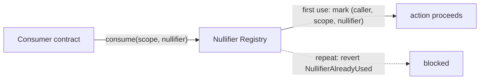

# Uniqueness Registry Specification

# Change Process

This document specifies one component of the identity-stack proof of concept, derived from
`src/NullifierRegistry.sol`. That implementation and its test suite are normative where
this prose is ambiguous.

# Language

The key words "MUST", "MUST NOT", "REQUIRED", "SHALL", "SHALL NOT", "SHOULD", "SHOULD
NOT", "RECOMMENDED", "MAY", and "OPTIONAL" are to be interpreted as described in
[RFC 2119](https://www.ietf.org/rfc/rfc2119.txt).

# Abstract

The Uniqueness Registry enforces **one action per person per context, without identifying
the person**. A nullifier is a value derived (inside a zero-knowledge circuit) from a
holder's secret and a context, deterministic for that pair, unlinkable to the holder, and
consumable exactly once. Consuming it in shared on-chain state gives "at most once per
context" with no registration, no biometrics on-chain, and no coordinator. Consumption is
namespaced by the calling contract, so independent consumers cannot collide with or grief
each other.

# Motivation

Anonymity without double-use protection is worthless for identity: an anonymous proof
could otherwise be replayed forever. The Sybil attack — one actor wearing many identities —
is the founding problem of open-participation systems (Douceur, 2002), and the literature's
honest conclusion is that it cannot be solved without an external anchor. The
proof-of-personhood line supplies anchors of varying strength; this component supplies the
*other half*: given any personhood credential, a nullifier turns it into "at most once per
context" without the context learning who acted.

For an institution the framing matters: many requirements written as identity requirements
— one vote, one claim, one account — are in fact **uniqueness requirements**. Meeting them
this way avoids collecting identity data that must then be secured, retained, and
eventually disposed of. This is the "narrower alternative" an evaluation should establish
before reaching for identity itself.

# Specification

## System Requirements

An implementation MUST provide:

- A one-time consumption operation that reverts on reuse.
- Namespacing of consumption by the calling contract.
- A public predicate reporting whether a given `(consumer, scope, nullifier)` triple has
  been consumed.

## Data Structures

```text
used:  mapping(address =>            // consumer (msg.sender)
         mapping(uint256 =>          //   scope
           mapping(uint256 =>        //     nullifier
             bool)))                 //       consumed
```

## Interface

| Function | Access | Effect |
|---|---|---|
| `consume(uint256 scope, uint256 nullifier)` | any contract (namespaced by caller) | Marks `(msg.sender, scope, nullifier)` used; reverts `NullifierAlreadyUsed` on repeat. |
| `used(address consumer, uint256 scope, uint256 nullifier) → bool` | view | Check. |

**Events.** `NullifierConsumed(consumer, scope, nullifier)`.

## Protocol Flow



1. A consumer contract (e.g. 11/PROOF-GATEWAY) verifies a zero-knowledge proof that yields
   a nullifier bound to `(holder secret, scope)`.
2. The consumer calls `consume(scope, nullifier)`.
3. A second attempt with the same triple reverts, enforcing one action per person per
   scope.

# Invariants

- **Exactly once.** A `(consumer, scope, nullifier)` triple transitions false→true exactly
  once, ever.
- **No holder information.** No information about the holder is derivable from a consumed
  nullifier — a property guaranteed by the generating circuit, recorded as fact here.
- **Caller namespacing.** Consumption is keyed by `msg.sender`, so independent consumers
  occupy disjoint namespaces.

# Security and Privacy Considerations

## Threat model

- **Sybil at issuance.** The registry enforces one mark per credential per context; if one
  person can obtain many credentials, uniqueness fails *upstream*. The personhood
  literature is the due-diligence reading for whichever issuers an operator accredits.
- **Cross-context linkage.** Prevented by construction — nullifiers in different scopes are
  unlinkable — but only if scopes are genuinely distinct values. Reusing a scope across
  unrelated applications collapses their separation.
- **Nullifier burning by observers.** A valid proof seen in transit can have its nullifier
  consumed by someone else first, permanently locking out the honest holder (the mark is
  deterministic and has no second attempt). Caller-namespacing here confines a burn to the
  observer's own namespace; a shared consumer (11/PROOF-GATEWAY) MUST additionally
  sub-namespace the scope — see that spec.
- **Secret compromise.** A stolen identity secret is the person, for every context.
  Device-level key protection and per-credential secrets bound the damage.

## Privacy

The registry stores only opaque triples; nothing person-identifying is written. Unlinkable
nullifiers across scopes are the mechanism by which acting in one context cannot be
correlated with acting in another.

## A note on shared consumers

Caller-namespacing isolates *direct* callers. A contract that consumes on behalf of many
applications collapses them into one namespace unless it sub-namespaces the scope itself —
11/PROOF-GATEWAY does exactly this (it consumes under `keccak256(consumer, scope)`). Any
other shared consumer MUST do the same, or one application can burn another's nullifiers.

# Interoperability

Nullifiers follow the Semaphore convention (a Poseidon hash of scope and identity secret),
so Semaphore-compatible provers produce values this registry can consume unchanged.

# Implementation Notes and Production Path

- **Ask whether uniqueness suffices** before requesting identity — it usually does, and it
  removes the retention problem entirely.
- **Derive scopes uniquely per programme** (and per epoch for recurring ones); never share
  a scope between unrelated applications.
- **Accredit personhood issuers deliberately**, using inclusion and equality criteria as
  seriously as security (see [References](#references)).
- **Consume only through consumer-namespaced paths** so observing a proof is never enough
  to burn it.
- **Future work:** cross-domain nullifier consistency (one action per person *across*
  chains) is an open research area — spends on two chains must not double-count.

# References

- Semaphore: Zero-Knowledge Signaling on Ethereum — https://docs.zkproof.org/pages/standards/accepted-workshop3/proposal-semaphore.pdf
- Proof-of-Personhood: Redemocratizing Permissionless Cryptocurrencies, IEEE S&PW 2017 — https://berkeley-defi.github.io/assets/material/Proof%20of%20Person.pdf
- Identity and Personhood in Digital Democracy, arXiv:2011.02412 — https://arxiv.org/pdf/2011.02412
- Who Watches the Watchmen? A Review of Subjective Approaches for Sybil-Resistance, Frontiers in Blockchain 2020 — https://www.frontiersin.org/journals/blockchain/articles/10.3389/fbloc.2020.590171/full
- RFC 2119 — https://www.ietf.org/rfc/rfc2119.txt

# Glossary

- **Nullifier.** A once-consumable, holder-unlinkable value bound to `(secret, scope)`.
- **Scope / context.** The topic under which a holder may act at most once.
- **Consumer.** The contract calling `consume`, whose address namespaces the mark.
