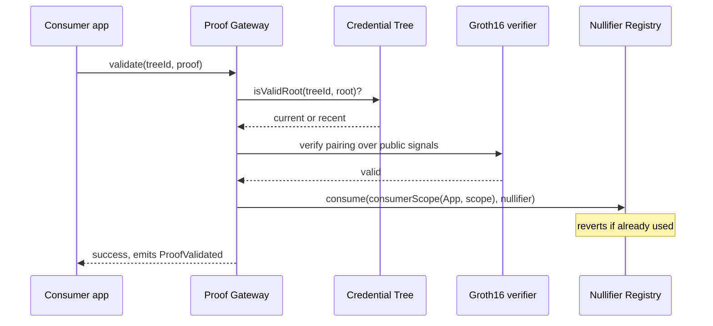

# Verification (Proof Gateway) Specification

# Abstract

The Proof Gateway performs credential verification in consensus: it wraps the
Semaphore v4 Groth16 verifier and checks, for a holder's proof, that (1) the Merkle tree
depth is in bounds, (2) the proof's root is current-or-recent in 09/CREDENTIAL-TREE-
REGISTRY (this is where ZK revocation bites), and (3) the pairing equation holds over the
public signals. The stateful entry point additionally consumes the proof's nullifier via
10/NULLIFIER-REGISTRY, namespaced per calling application. Any contract thereby gains "this
caller holds a valid, unrevoked credential from issuer X and has not acted in this scope
before" as a composable primitive, with no verification service anywhere.

# Status of This Memo

This document is a working specification derived from a reference implementation. It is **not** an IETF document and has not been reviewed by any IETF working group; it is distributed for evaluation and discussion. It adopts IETF conventions — BCP 14 requirement keywords, Security and Privacy Considerations, an IANA Considerations section, and split references — so that institutional reviewers can read it against familiar structure, but it claims no IETF status.

Changes are made by pull request against the source repository. The reference implementation in `src/ProofGateway.sol` and its test suite are normative where this prose is ambiguous.

# Copyright Notice

This specification is published under the MIT license of the repository that contains it (see `LICENSE`). Contributors retain copyright in their contributions and license them under those terms. A formal IETF submission would instead be governed by the IETF Trust's Legal Provisions (BCP 78) and the rights described in BCP 79; this notice is provided in their place for a non-IETF document.

# Conventions and Terminology

The key words "MUST", "MUST NOT", "REQUIRED", "SHALL", "SHALL NOT", "SHOULD", "SHOULD
NOT", "RECOMMENDED", "MAY", and "OPTIONAL" in this document are to be interpreted as
described in BCP 14 [RFC2119] [RFC8174] when, and only when, they appear in all
capitals, as shown here.

## Terminology

- **Groth16.** A compact pairing-based zk-SNARK requiring a per-circuit trusted setup.
- **Public signals.** The inputs the verifier checks the proof against: root, nullifier,
  hashed message, hashed scope.
- **Malleability.** The ability to derive a different valid proof of the same statement.
- **`consumerScope`.** The per-caller nullifier namespace, `keccak256(consumer, scope)`.

# Introduction

Verification is normally a service: a company that can log you, profile you, price the
check, be pressured about whom it serves, or simply go down. Replacing it with a pairing
equation in consensus removes all of that — the verifier "can't log you, profile you,
censor you, or go down, because it's mathematics in consensus, not a company."

The proof system is Groth16, the most compact and cheapest-to-verify SNARK, which is why
it dominates on-chain use. An implementer MUST absorb three facts from its literature (see
[References](#references)): its knowledge-soundness proof; its **per-circuit trusted
setup**, made acceptable by multi-party ceremonies where a single honest participant
suffices; and its **malleability** — a Groth16 proof can be re-randomised into a different
valid proof of the same statement, so a design MUST NEVER treat proof bytes as unique.
Uniqueness here comes from the nullifier, never the proof.

The second relevant body of work is front-running. The blockchain front-running literature
establishes that anything valuable and visible in transit will be raced; for this design
the racing target is the nullifier, and the mitigation is described under
[Threat model](#threat-model).

# Specification

## System Requirements

An implementation MUST provide:

- A stateless verification predicate: depth bounds, root recency, pairing check.
- A stateful verification entry point that additionally consumes the nullifier atomically.
- Per-consumer namespacing of nullifier consumption.

## Data Structures

```text
Proof {
  uint256 merkleTreeDepth;
  uint256 merkleTreeRoot;
  uint256 nullifier;
  uint256 message;      // binds arbitrary data, e.g. the recipient address
  uint256 scope;        // the nullifier context
  uint256[8] points;    // the Groth16 proof points
}
```

Public signals presented to the verifier are `[merkleTreeRoot, nullifier, hash(message),
hash(scope)]`, where `hash(x) = keccak256(abi.encodePacked(x)) >> 8` (the Semaphore
convention shifting into the SNARK scalar field).

## Interface

| Function | Access | Effect |
|---|---|---|
| `verify(uint256 treeId, Proof proof) → bool` | view | Stateless: depth bounds (1–32), `trees.isValidRoot`, and the pairing check. Reverts `UnsupportedTreeDepth` / `UnknownOrExpiredRoot`. |
| `validate(uint256 treeId, Proof proof)` | anyone | Stateful: `verify`, then consume the nullifier under `(msg.sender, scope)`. Reverts on any failure. |
| `consumerScope(address consumer, uint256 scope) → uint256` | pure | `keccak256(abi.encode(consumer, scope))` — the namespace `validate` writes under. |

**Errors.** `InvalidProof`, `UnknownOrExpiredRoot`, `UnsupportedTreeDepth`. **Events.**
`ProofValidated(treeId, consumer, scope, nullifier, message)`.

## Protocol Flow



1. A holder generates a Semaphore v4 proof over the public signals above, choosing
   `message` and `scope` per the consuming application's rules.
2. The consuming application calls `validate(treeId, proof)`.
3. The gateway verifies the proof and consumes the nullifier under
   `consumerScope(msg.sender, scope)`.
4. The consumer MUST separately check `message`/`scope` semantics (see 15/GATED-AIRDROP) —
   the gateway proves credential validity, not application intent.

# Invariants

- **Bounded validity in time.** A proof valid at time T against root R stays valid only
  while R is within its tree's root-history window.
- **Atomic validation.** No nullifier is consumed for a failed proof, and no valid proof
  lands twice under the same `(consumer, scope)`.
- **Per-consumer namespace.** Nullifiers are namespaced by the *calling contract*, not by
  the gateway — see the threat model for why this is load-bearing.

# Security and Privacy Considerations

## Threat model

- **Trusted-setup subversion.** Groth16 requires a per-circuit ceremony; a fully
  compromised ceremony can forge proofs. Multi-party setups reduce this to "at least one
  participant was honest." An implementer SHOULD verify which ceremony its circuit inherits
  and who participated.
- **Proof malleability.** Valid proofs can be re-randomised into other valid proofs of the
  same statement. Any replay protection keyed on proof bytes is broken by construction;
  keying MUST be on the nullifier.
- **Nullifier burning via observation.** Because `validate` is permissionless and the
  gateway never inspects `message`, a gateway-wide nullifier namespace would let an
  observer copy a pending proof from the mempool, front-run the intended consumer, and burn
  the nullifier — permanently excluding an honest holder from that scope while gaining
  nothing. This is a suppression attack in the sense of the front-running literature.
  Mitigated here by namespacing consumption per consumer (`consumerScope`) and by
  applications binding the recipient into `message`; a regression test
  (`test_DirectGatewayValidateCannotBurnClaim`) covers it.
- **Stale-state acceptance.** Proofs verify against recent accumulator state; the
  acceptance window is the revocation delay, inherited from and tuned in
  09/CREDENTIAL-TREE-REGISTRY.
- **Circuit-implementation gap.** Deployed circuits drift from the papers describing them;
  audit the circuit and its constraint system, not only the contract.

## Privacy

The gateway learns nothing about the holder beyond membership; it cannot log, profile, or
discriminate, because it is a pairing equation, not an organisation. `message` binding
means a proof lifted from the mempool is useless to any other sender.

# Interoperability

`Proof` is exactly Semaphore v4's proof shape, so any Semaphore wallet/prover tooling works
unchanged. Wrapping verification behind this interface allows a future proof system
(universal-setup or transparent) to replace Groth16 without migrating consumers.

# Implementation Notes and Production Path

- **Inherit a public multi-party ceremony** and record its transcript in the evaluation
  file rather than running a private setup.
- **Never use proof bytes as an identifier** — for deduplication, receipts, or logging use
  the nullifier.
- **Keep verification namespaced per consumer** and bind the recipient into every proof.
- **Audit at three levels:** circuit constraints, verifier contract, and the integration
  that calls it.
- **Plan for proof-system succession** behind the interface.
- **Future work:** multiple circuits (disclosure and range proofs — "over 18"),
  aggregated/recursive proofs for batch verification.

# IANA Considerations

This document requests no IANA actions.

# Normative References

- [RFC2119] Bradner, S., "Key words for use in RFCs to Indicate Requirement Levels", BCP 14, RFC 2119, March 1997 — https://www.rfc-editor.org/rfc/rfc2119
- [RFC8174] Leiba, B., "Ambiguity of Uppercase vs Lowercase in RFC 2119 Key Words", BCP 14, RFC 8174, May 2017 — https://www.rfc-editor.org/rfc/rfc8174
- On the Size of Pairing-Based Non-interactive Arguments (Groth16), IACR ePrint 2016/260 — https://eprint.iacr.org/2016/260

# Informative References

- Another Look at Extraction and Randomization of Groth's zk-SNARK, IACR ePrint 2020/811 — https://eprint.iacr.org/2020/811
- SoK: Understanding zk-SNARKs — The Gap Between Research and Practice, IACR ePrint 2025/172 — https://eprint.iacr.org/2025/172
- Flash Boys 2.0: Frontrunning, Transaction Reordering, and Consensus Instability, IEEE S&P 2020 — https://arxiv.org/abs/1904.05234
- SoK: Transparent Dishonesty — Front-Running Attacks on Blockchain, FC 2019 — https://arxiv.org/pdf/1902.05164
