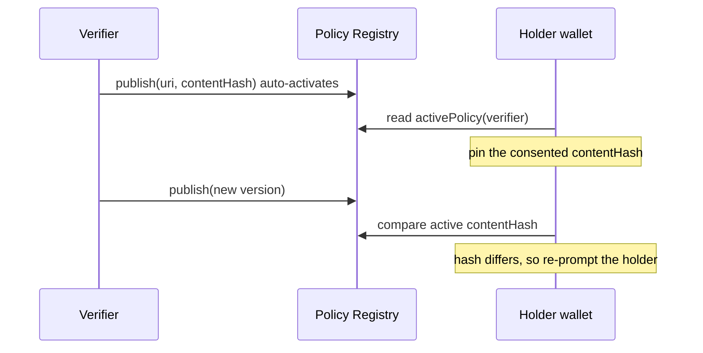

# Disclosure Policy Registry Specification

# Abstract

The Disclosure Policy Registry lets verifiers publish immutable, versioned commitments
about what they request and what they retain. The policy document lives off-chain; its URI
and content hash are appended here, and each publication auto-activates. A wallet pins the
content hash the holder consented to and re-prompts when the active hash changes. This
moves data-minimisation from retrospective audit to refusal at the point of request, and
makes every policy change a permanent, timestamped public diff.

# Status of This Memo

This document is a working specification derived from a reference implementation. It is **not** an IETF document and has not been reviewed by any IETF working group; it is distributed for evaluation and discussion. It adopts IETF conventions — BCP 14 requirement keywords, Security and Privacy Considerations, an IANA Considerations section, and split references — so that institutional reviewers can read it against familiar structure, but it claims no IETF status.

Changes are made by pull request against the source repository. The reference implementation in `src/PolicyRegistry.sol` and its test suite are normative where this prose is ambiguous.

# Copyright Notice

This specification is published under the MIT license of the repository that contains it (see `LICENSE`). Contributors retain copyright in their contributions and license them under those terms. A formal IETF submission would instead be governed by the IETF Trust's Legal Provisions (BCP 78) and the rights described in BCP 79; this notice is provided in their place for a non-IETF document.

# Conventions and Terminology

The key words "MUST", "MUST NOT", "REQUIRED", "SHALL", "SHALL NOT", "SHOULD", "SHOULD
NOT", "RECOMMENDED", "MAY", and "OPTIONAL" in this document are to be interpreted as
described in BCP 14 [RFC2119] [RFC8174] when, and only when, they appear in all
capitals, as shown here.

## Terminology

- **Policy version.** An append-only, hash-pinned statement of what a verifier requests and
  retains.
- **Active policy.** The single currently-governing version, or none.
- **Pinning.** A wallet recording the exact version a holder consented to.

# Introduction

Machine-readable privacy policies have been tried: P3P standardised them for the web two
decades ago and failed for lack of enforcement pull — sites could publish anything and
browsers had nothing to hold them to. The two missing ingredients were **immutability** of
the published policy and **a counterparty with the power to refuse**. This design supplies
both: versions are append-only and permanent, and the wallet — which holds what the
verifier wants — can decline mechanically.

The data-minimisation literature around eIDAS 2.0 and GDPR frames the shift precisely:
selective disclosure changes *what can be asked*; policy pinning changes *what happens when
the ask grows*. Together they move enforcement to before the data moves.

# Specification

## System Requirements

An implementation MUST provide:

- Append-only publication of policy versions, each auto-activating.
- An owner-controlled switch among already-published versions (never an edit).
- Read access to the active policy and to the full version history.

## Data Structures

```text
Policy  { string uri; bytes32 contentHash; uint64 publishedAt }

_policies: mapping(address => Policy[])   // verifier => append-only versions
_active:   mapping(address => uint256)    // verifier => (active index + 1); 0 == none
```

## Interface

| Function | Access | Effect |
|---|---|---|
| `publish(address verifier, string uri, bytes32 contentHash) → uint256 policyId` | verifier owner | Append a version and make it active. |
| `setActive(address verifier, uint256 policyId)` | verifier owner | Switch among published versions; MUST reference an existing one. |
| `activePolicy(address verifier) → (uint256 policyId, Policy)` | view | The currently-active version; reverts `NoSuchPolicy` if none. |
| `policyCount(address verifier) → uint256` | view | Number of versions. |
| `policyAt(address verifier, uint256 policyId) → Policy` | view | Any historical version. |

**Errors.** `NoSuchPolicy`. **Events.** `PolicyPublished(verifier, policyId, uri,
contentHash)`, `ActivePolicyChanged(verifier, policyId)`.

## Protocol Flow



1. A verifier `publish`es a policy (accepted schemas, trusted roots, retention promise,
   purpose live in the off-chain document; its hash is pinned here).
2. A wallet, on first interaction, records the active `contentHash` the holder consented
   to.
3. On each subsequent interaction the wallet compares the active hash; if it changed, the
   wallet re-prompts the holder before proceeding.

# Invariants

- **Append-only and immutable.** Versions are never edited; the full history of a
  verifier's asks is permanently public.
- **Zero or one active version.** Exactly zero or one policy is active per verifier at any
  time.

# Security and Privacy Considerations

## Threat model

- **Policy–practice divergence.** A published policy is a commitment, not a guarantee of
  behaviour; its force is evidentiary — divergence becomes provable against a permanent
  record, which is what regulators and litigants lacked under P3P.
- **Pinning without parsing.** Hashes detect change but cannot evaluate content. Until a
  machine-readable format is adopted, wallets can only re-prompt on change — meaningful,
  but short of automatic refusal.
- **Consent fatigue.** Re-prompting on every version change trains users to click through.
  Wallets SHOULD diff and summarise what changed, not merely announce that something did.
- **Version rollback games.** Switching the active version among published ones is
  legitimate and auditable; interfaces MUST always show which version governed a given
  interaction.

## Privacy

The registry stores policy references, not personal data. Its privacy value is the
enforcement model it enables: refusal before disclosure, and a permanent public record of
what was asked.

# Interoperability

Policies SHOULD converge on a machine-readable format — a presentation-definition dialect
with retention fields — so wallets can *evaluate* rather than merely pin. Policy references
SHOULD be wired into 14/PAYMENT-RAILS receipts so payments prove which policy governed each
verification.

# Implementation Notes and Production Path

- **Adopt a machine-readable policy format** so wallets can evaluate automatically.
- **Keep policies small and per-purpose** — one policy per programme beats one omnibus
  policy amended forever.
- **Treat the version history as a compliance asset**: it is a demonstrable minimisation
  record produced as a side effect of operating.

# IANA Considerations

This document requests no IANA actions.

# Normative References

- [RFC2119] Bradner, S., "Key words for use in RFCs to Indicate Requirement Levels", BCP 14, RFC 2119, March 1997 — https://www.rfc-editor.org/rfc/rfc2119
- [RFC8174] Leiba, B., "Ambiguity of Uppercase vs Lowercase in RFC 2119 Key Words", BCP 14, RFC 8174, May 2017 — https://www.rfc-editor.org/rfc/rfc8174

# Informative References

- The Platform for Privacy Preferences 1.1 (P3P1.1), W3C — https://www.w3.org/TR/P3P11/
- The impact of zero-knowledge proofs on data minimisation compliance of digital identity wallets, Internet Policy Review — https://policyreview.info/articles/analysis/impact-zero-knowledge-proofs
- Self-Sovereign Identity and eIDAS 2.0, arXiv:2601.19837 — https://arxiv.org/pdf/2601.19837
- BLS-MT-ZKP: A novel approach to selective disclosure of claims from digital credentials, arXiv:2402.15447 — https://arxiv.org/pdf/2402.15447
