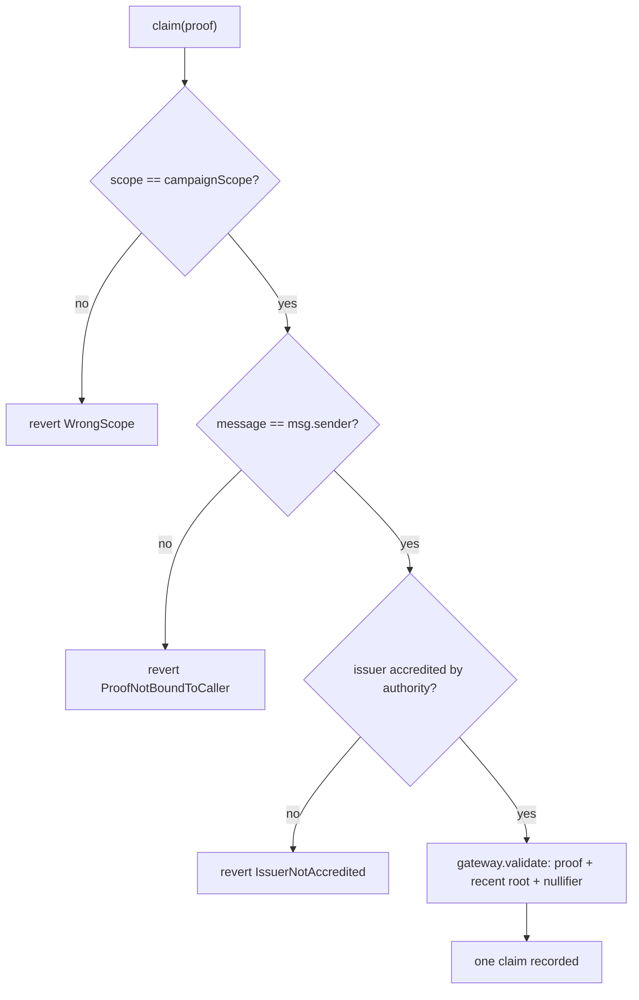

# Worked Example: Gated Distribution Specification

# Abstract

Gated Distribution is the payoff of the stack in roughly forty lines of application code:
one claim per person (not per address), restricted to holders of a credential from an
issuer that a chosen authority has accredited, with the claimant unknown to the contract
and a proof lifted from the mempool useless to its thief. It implements none of identity,
trust, revocation, privacy, or uniqueness itself — it inherits all five through calls
into the stack.

# Status of This Memo

This document is a working specification derived from a reference implementation. It is **not** an IETF document and has not been reviewed by any IETF working group; it is distributed for evaluation and discussion. It adopts IETF conventions — BCP 14 requirement keywords, Security and Privacy Considerations, an IANA Considerations section, and split references — so that institutional reviewers can read it against familiar structure, but it claims no IETF status.

Changes are made by pull request against the source repository. The reference implementation in `src/GatedAirdrop.sol` and its test suite are normative where this prose is ambiguous.

# Copyright Notice

This specification is published under the MIT license of the repository that contains it (see `LICENSE`). Contributors retain copyright in their contributions and license them under those terms. A formal IETF submission would instead be governed by the IETF Trust's Legal Provisions (BCP 78) and the rights described in BCP 79; this notice is provided in their place for a non-IETF document.

# Conventions and Terminology

The key words "MUST", "MUST NOT", "REQUIRED", "SHALL", "SHALL NOT", "SHOULD", "SHOULD
NOT", "RECOMMENDED", "MAY", and "OPTIONAL" in this document are to be interpreted as
described in BCP 14 [RFC2119] [RFC8174] when, and only when, they appear in all
capitals, as shown here.

## Terminology

- **Campaign scope.** The nullifier context for one distribution; makes claims
  one-per-person within it and unlinkable across scopes.
- **Recipient binding.** Committing the claimant's address inside the proof.
- **Inheritance.** Gaining identity, trust, revocation, privacy, and uniqueness by
  composition rather than implementation.

# Introduction

Distribution is where Sybil pressure is measured, not theorised: empirical airdrop studies
(see [References](#references)) document industrial-scale farming — thousands of
coordinated addresses in star and chain funding patterns, profitable at scale — and the
detection literature is an arms race of behavioural clustering precisely because
address-level identity carries no uniqueness. Per-person gating changes the unit of defence
from behaviour to personhood.

As the composition example, it also demonstrates the inheritance argument that is the whole
case for building on shared infrastructure: four checks against the stack buy all five
properties, and every later improvement to any component accrues to the application
unchanged.

# Specification

## System Requirements

The application MUST, in `claim(proof)`, enforce in order:

1. **Context binding** — `proof.scope == campaignScope`, so the same person's actions in
   other scopes remain unlinkable to this one.
2. **Recipient binding** — `proof.message == uint256(uint160(msg.sender))`, so a proof
   intercepted in transit is useless to any other sender.
3. **Live policy check** — `TrustRegistry.isAccredited(authority, issuer, ROLE_ISSUER,
   schema)`, so de-accrediting the issuer stops claims immediately, mid-campaign.
4. **Proof and uniqueness** — `ProofGateway.validate(treeId, proof)`, which performs
   Groth16 verification, root recency (revocation), and nullifier consumption
   (one-per-person).

## Data Structures

```text
gateway:          ProofGateway (immutable)
trees:            CredentialTreeRegistry (immutable)
trust:            TrustRegistry (immutable)
trustedAuthority: address (immutable)
requiredSchema:   bytes32 (immutable)
treeId:           uint256 (immutable)
campaignScope:    uint256 (immutable)
claims:           mapping(address => uint256)
```

## Interface

| Function | Access | Effect |
|---|---|---|
| `claim(ProofGateway.Proof proof)` | anyone | Enforce the four checks; on success, record the claim and emit `Claimed`. |

**Errors.** `WrongScope`, `ProofNotBoundToCaller`, `IssuerNotAccredited`; plus, from the
gateway, invalid-proof / stale-root / reused-nullifier reverts. **Events.**
`Claimed(recipient, nullifier)`.

## Protocol Flow



1. A holder holds a credential whose commitment is in `treeId`.
2. The holder builds a proof with `scope = campaignScope` and `message =
   uint160(their address)`.
3. The holder calls `claim(proof)`; the contract runs the four checks and the gateway
   consumes the nullifier under `(this contract, campaignScope)`.

# Invariants (verified with real proofs)

- **One person, one claim.** The same person, two proofs, two different wallets → the
  second reverts `NullifierAlreadyUsed`.
- **Different person succeeds.** A distinct credential holder claims successfully.
- **Bound to caller.** A stolen proof presented by another address reverts
  `ProofNotBoundToCaller`.
- **Live trust.** An issuer de-accredited by the authority → claims stop
  (`IssuerNotAccredited`).

# Security and Privacy Considerations

## Threat model

- **Sybil at the credential layer.** Gating is only as unique as the personhood credential
  behind it; issuer accreditation is the control surface, and the empirical studies show
  what weak anchors cost.
- **Claim interception.** A proof observed in transit MUST be worthless to the observer:
  recipient binding handles theft, consumer-namespaced nullifiers (11/PROOF-GATEWAY) handle
  burning. Both are regression-tested.
- **Anonymity-set erosion.** A distribution with few eligible holders identifies claimants
  nearly individually; the tree-composition caveat of 09/CREDENTIAL-TREE-REGISTRY applies
  with full force to eligibility design.
- **Mid-campaign trust changes.** Live accreditation checks mean a de-accredited issuer
  stops claims immediately — powerful, but its governance (who may pull the trigger, with
  what notice) belongs in programme terms, not left to be discovered.

## Privacy

The contract never learns who claimed — only that each claimant was unique and
credentialed. No personal data is involved at any step.

# Interoperability

The pattern generalises: swap the claim counter for an ERC-20 mint, use per-epoch scopes
for recurring distributions, and accept multiple issuers via `TrustRegistry.checkChain`
for federated trust.

# Implementation Notes and Production Path

- **Size eligibility populations deliberately** — small eligible sets undo the privacy the
  proof provides.
- **Use per-epoch contexts for recurring distributions** so each round is one-per-person
  without linking rounds.
- **Write the de-accreditation procedure into programme terms**: the kill-switch is
  powerful and should be governed, not discovered.
- **Publish the four checks in plain language** to participants — the legibility of the
  rule is itself Sybil deterrence.

# IANA Considerations

This document requests no IANA actions.

# Normative References

- [RFC2119] Bradner, S., "Key words for use in RFCs to Indicate Requirement Levels", BCP 14, RFC 2119, March 1997 — https://www.rfc-editor.org/rfc/rfc2119
- [RFC8174] Leiba, B., "Ambiguity of Uppercase vs Lowercase in RFC 2119 Key Words", BCP 14, RFC 8174, May 2017 — https://www.rfc-editor.org/rfc/rfc8174

# Informative References

- Toward Resilient Airdrop Mechanisms: Empirical Measurement of Hunter Profits, arXiv:2503.14316 — https://arxiv.org/pdf/2503.14316
- Detecting Sybil Addresses in Blockchain Airdrops, arXiv:2505.09313 — https://arxiv.org/pdf/2505.09313
- TierDrop: Harnessing Airdrop Farmers for User Growth, arXiv:2407.01176 — https://arxiv.org/pdf/2407.01176
- Flash Boys 2.0, IEEE S&P 2020 — https://arxiv.org/abs/1904.05234
